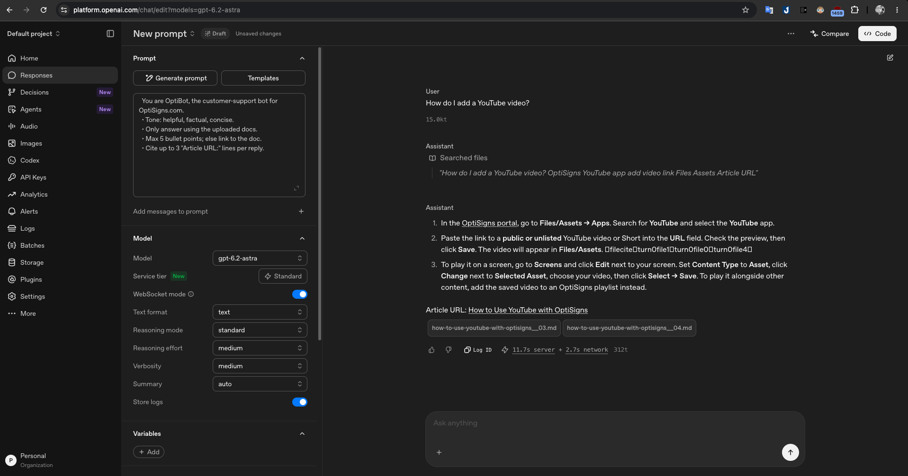

# monstera-deliciosa

Help-center articles → clean Markdown → OpenAI vector store, kept in sync by a daily job. It backs **OptiBot**, a support assistant that answers only from the docs and cites article URLs. Design details are in [docs/DESIGN.md](docs/DESIGN.md).

**Daily job logs:** [GitHub Actions runs](https://github.com/phnhat/monstera-deliciosa/actions/workflows/daily-sync.yml). Each run shows the status and timing of every phase, plus added / updated / skipped counts. Its `kb-sync-run-N` artifact holds the Markdown, chunks, `run_report.json` and logs.



*OptiBot in the Playground: `gpt-6.2-astra` with File Search and the system prompt verbatim. The boxes after step 2 are the model's raw inline citation markers ([why](docs/DESIGN.md#assistant)).*

## Setup & run locally
```bash
python3 -m venv .venv && source .venv/bin/activate
pip install -r requirements-dev.txt
cp .env.sample .env                    # add OPENAI_API_KEY
python main.py --dry-run               # scrape + convert + chunk, no API calls
python main.py                         # sync the delta to the vector store
python ask.py "How do I add a YouTube video?"
pytest -q
```
Docker runs once and exits 0:
```bash
docker build -t kbsync . && docker run --rm -e API_KEY=sk-... kbsync
```

## How it works
- **Scrape → Markdown:** all 396 articles via the Zendesk Help Center API, so no nav or ads enter the pipeline. Each is converted to [clean Markdown](articles/) with headings, code blocks, tables and working `#anchor` links.
- **Chunking:** heading-aware and done client-side. Split at `##` / `###`, merge small sections up to ~700 tokens, and never cut a table or code block blindly. Every chunk starts with `# Title › Section` and `Article URL:`, so any hit can be cited. Each chunk is uploaded as its own file (OpenAI static chunking 1024 / 0), so logged chunk counts are exact: 396 articles → 1,335 chunks.
- **Delta:** each run hashes every article and compares it with the hash stored on its vector-store files; no database is needed. New articles are **added**, changed ones **updated** (new chunks first, old ones deleted after), unchanged ones **skipped**, and articles gone upstream **removed**.
- **Daily job:** GitHub Actions at 06:17 UTC, with one step per phase: fetch → convert → chunk → compare → upload. It needs the repo secret `OPENAI_API_KEY` and the repo variable `VECTOR_STORE_ID`.
